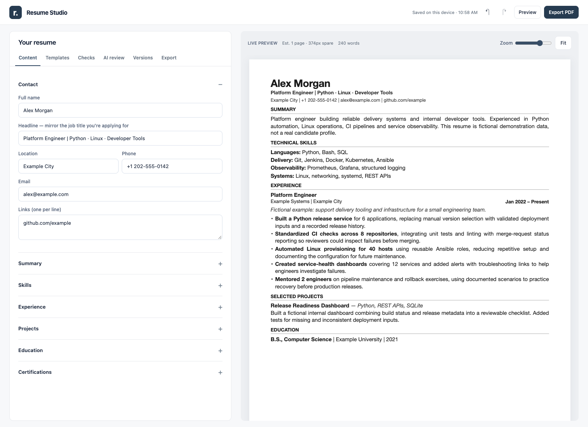

# Resume Builder

**A local-first resume workspace with eight templates, live preview, optional AI review, and a portable CLI.**

Build and tailor your resume, save application-specific versions, and export a selectable-text PDF. Run the editor offline, connect your installed OpenCode locally, or publish a blank static site for others.

[Setup](SETUP.md) · [User guide](GUIDE.md) · [Architecture](docs/ARCHITECTURE.md) · [Deployment](DEPLOYMENT.md) · [Contributing](CONTRIBUTING.md)



> Readiness checks are local writing/formatting heuristics—not an employer's ATS score. No template or AI review guarantees a screening pass or job offer.

## Quick start

Clone this repository or download its source ZIP, then open a terminal in the project folder.

### macOS / Linux

```sh
./resume-builder setup_guide    # Works before Python is installed
./resume-builder start          # Requires Python 3.9+
```

If executable permissions were lost: `chmod +x resume-builder`, or run `sh ./resume-builder setup_guide`.

### Windows PowerShell

```powershell
.\resume-builder.cmd setup_guide
.\resume-builder.cmd start
```

In Windows Command Prompt, omit the leading `.\`.

The launcher opens **http://127.0.0.1:8765**. No third-party Python packages, Node.js, database, or build step are needed to run it. For the editor alone, open `index.html` directly in a modern browser; local OpenCode review requires the server.

### Install the short command once

```sh
# macOS / Linux
python3 install_cli.py
```

```powershell
# Windows
py -3 install_cli.py --add-path
```

Follow the printed PATH instructions and open a new terminal. Then, from any directory:

```sh
resume-builder start
resume-builder stop
resume-builder --help
```

If the app folder or Python installation moves, rerun the installer. See [SETUP.md](SETUP.md) for all prerequisites and troubleshooting.

## Features

| Area | Included |
|---|---|
| Editing | Contact, summary, skills, experience, projects, education, certifications; reorderable entries |
| Workspace | Collapsible sections, live A4 preview, word count, focus view, undo/redo |
| Templates | ATS Classic, Compact, Serif Modern, Impact, Engineering, Executive, Minimal, Academic |
| Customization | Font size, line spacing, margins, heading colour, one-page Auto-fit |
| Versions | Up to 30 named resume versions; backup/import all versions |
| Checks | Section completeness, dates, bullet length, wording, numerical claims, basic job-keyword comparison |
| AI | OpenCode model discovery, review/cancel, optional direct provider APIs, prompt export |
| Export | Native-print PDF, Markdown, resume JSON, versions JSON, AI-review text |
| Operations | Setup guide, dependency checks, managed start/stop, static builds, ZIP packaging, containers and pods |

Templates use a single reading column, conventional headings, and real PDF text. Some content/template combinations need two pages; check the browser print preview before saving.

## Commands

After installing the command, use the same syntax on macOS, Windows, and Linux:

```sh
resume-builder setup_guide       # First-time setup instructions
resume-builder setup             # Check runtime; no packages to install
resume-builder doctor            # Check optional tools
resume-builder start             # Start background server and open browser
resume-builder status
resume-builder logs
resume-builder stop
resume-builder restart
resume-builder guide             # Stack, features and workflow
resume-builder build             # Blank public site -> dist/
resume-builder package           # Portable app -> resume-studio.zip
resume-builder container up      # Requires Docker Engine + Compose
resume-builder container down
resume-builder pods --help       # Requires your cluster/registry setup
```

Before installation, use `./resume-builder` (macOS/Linux) or `.\resume-builder.cmd` (Windows PowerShell). `python3 studio.py ...` / `py -3 studio.py ...` remain available as fallbacks.

## AI review

### Local OpenCode

1. Install [OpenCode](https://opencode.ai/docs/) and configure a model/provider login.
2. Verify `opencode --version` and `opencode models` in your terminal.
3. Start this app through its launcher.
4. Open **AI review → OpenCode**, select a model, and analyze the resume.

The bridge invokes `opencode run --format json` using a process-scoped review agent. Tools are denied and inherited MCP integrations disabled for the review. Global OpenCode configuration is not edited. Provider usage limits apply; the selected provider receives your resume/job text, and OpenCode may retain local session history.

Anthropic/OpenAI direct-API modes use a key held only in the open tab. Browser cross-origin restrictions may prevent a provider call. **Export prompt for any AI** is available without an API connection. Suggestions are never silently applied to your resume.

## Local, public and portable

| Mode | How | OpenCode access |
|---|---|---|
| Offline editor | Open `index.html` | No |
| Personal local app | `resume-builder start` | Your installed CLI |
| Public static site | Build and deploy `dist/` | Disabled |
| Public container | `resume-builder container up` | Disabled |

Public builds start blank and do not expose the host's OpenCode account. Visitors keep drafts in their own browsers; there is no shared database, login system, or cloud sync. Details: [privacy](PRIVACY.md), [architecture](docs/ARCHITECTURE.md), [hosting](DEPLOYMENT.md).

To move between laptops, export JSON from the app and import it on the other machine. Browser storage differs by browser and URL, including different ports. Copying the source folder does not copy saved drafts. Export backups before clearing browser data.

## Technology

- **UI:** HTML, CSS, vanilla JavaScript; no CDN or front-end framework required.
- **Local server and CLI:** Python 3.9+ standard library.
- **Storage:** browser localStorage, with JSON import/export.
- **PDF:** native browser printing with selectable text.
- **Public deployment:** static assets; Docker + Caddy; Kubernetes manifest generation.
- **Development tests:** unittest, Playwright and pypdf. CI uses mocked AI; no provider credentials required.

The Python HTTP server is intended for local/development use. Use static hosting or the Caddy container for public deployment.

## Development

```sh
python3 test_operations.py       # Standard-library CLI/release tests
python3 studio.py setup --dev   # Creates .venv and installs optional test dependencies
# Activate .venv, then:
python test_studio.py           # Uses installed Google Chrome, mocked AI
```

For Playwright-managed Chromium instead: `python -m playwright install chromium`, then `python test_studio.py --browser chromium`.

An optional real-provider test is available with `--live --model provider/model`; it sends synthetic content and may incur provider usage. See [CONTRIBUTING.md](CONTRIBUTING.md).

## Project layout

```text
index.html                 Dashboard, templates, local checks and exports
resume-builder[.cmd]       Dependency-free setup-guide bootstrap / CLI entry
studio.py                  Operations CLI
install_cli.py             One-time command installer
server.py                  Local HTTP server and OpenCode bridge
release.py                 Public-build generator
examples/                  Fictional resume fixture
docs/                      Architecture, screenshots and publishing guide
.github/workflows/         Tests and manual GitHub Pages deployment
Dockerfile / compose.yaml  Public static container
test_*.py                  CLI, release and browser tests
```

## Status and limitations

Local development has been verified on macOS with Chrome. CI is configured to exercise Windows, macOS and Linux operations, plus browser/PDF tests on Linux; the workflow runs after you push. Native Windows and live Kubernetes deployment have not yet been verified locally. Docker requires a running engine.

Found a problem? Open an issue with reproduction steps and **fictional** resume data. For sensitive reports, follow [SECURITY.md](SECURITY.md).

## License

[MIT](LICENSE). Contributions are welcome; see [CONTRIBUTING.md](CONTRIBUTING.md).
