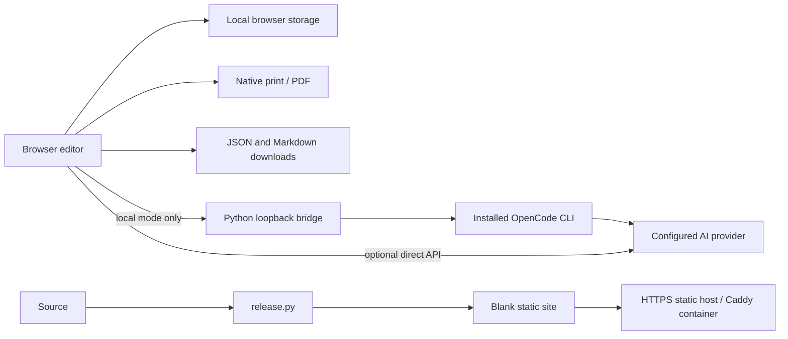

# Architecture

## Components

`index.html` is the complete offline-capable UI, including templates, form handling,
history, version storage, local checks and exports. It has no JavaScript build step.
`server.py` serves it locally and bridges explicit AI requests to OpenCode. Review
jobs run in a subprocess with an isolated working directory and process-scoped
permissions; a result is polled by a random job ID.

`studio.py` manages background instances through `.studio/instance.json` and a
private shutdown token. It checks instance identity before stopping a server rather
than sending a signal to an arbitrary saved PID. `install_cli.py` creates a small
platform-specific launcher pointing to the project and Python executable.

`release.py` replaces the source seed with a blank resume and switches the public
artifact into hosted mode. Docker builds this artifact and serves only static files
with Caddy. Kubernetes commands generate/apply a Deployment and ClusterIP Service;
registry, ingress, DNS and TLS provisioning remain operator responsibilities.

## Storage and trust

No database, accounts, remote draft storage or cloud synchronization are present.
Drafts and versions are localStorage data; they are not an encrypted vault. The UI
escapes resume text before rendering. Imported JSON is validated before replacing
the current draft. API keys are not persisted by the current UI.

Hosted mode deliberately has no personal CLI integration. A public browser cannot
invoke a visitor's installed OpenCode directly, and the host does not share its
subscription with visitors. Direct-API or exported-prompt workflows are available.

## Known limitations

- Keyword matching is lexical, not a model of an employer's screening system.
- Printed pagination can vary with platform fonts/browser settings.
- OpenCode CLI/config interfaces can change; model discovery and an optional live
  integration test help verify the installed version.
- Direct AI APIs may reject browser cross-origin calls.
- No server-side PDF generation, DOCX import, user accounts or multi-user AI backend.
